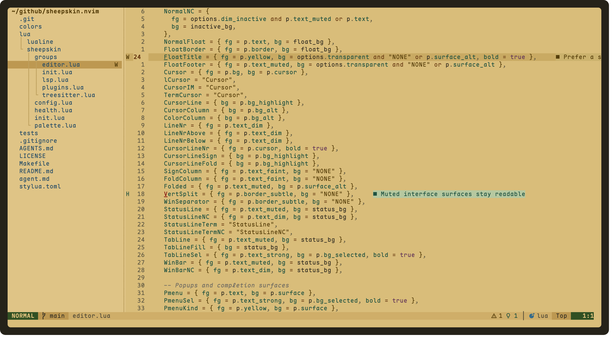

# sheepskin.nvim

一款为长时间编码设计的暖黄色 Neovim 主题。低饱和、低蓝光、不过度灰暗，
同时保留清晰的语法层次和完整插件支持。

[](https://github.com/wsgggws/sheepskin.nvim/actions/workflows/ci.yml)


<p align="center">
  
</p>

## 特点

- 浅色使用暗黄纸张背景 `#d9bd7a`，深色使用暖橄榄背景 `#302b18`。
- 正文与语法色保持清晰对比，注释使用低存在感的灰色斜体。
- 支持 Tree-sitter、LSP、诊断、diff、搜索、补全和终端色。
- 内置 lualine 主题，并预置 Snacks、Telescope、neo-tree、nvim-tree、
  bufferline、gitsigns、which-key、ibl、blink.cmp、nvim-cmp、Trouble、
  Noice、Notify、DAP、dashboard 等扩展高亮。
- 核心不依赖第三方插件，支持透明背景和失焦窗口淡化。

## 安装

需要 Neovim 0.9+ 并启用 `termguicolors`。

### lazy.nvim

```lua
{
  "wsgggws/sheepskin.nvim",
  lazy = false,
  priority = 1000,
  opts = {
    variant = "auto",
  },
  config = function(_, opts)
    require("sheepskin").setup(opts)
    vim.cmd.colorscheme("sheepskin")
  end,
}
```

本地开发时把仓库地址替换为：

```lua
dir = "~/github/sheepskin.nvim",
```

### LazyVim

新建 `lua/plugins/sheepskin.lua`：

```lua
return {
  {
    "wsgggws/sheepskin.nvim",
    lazy = false,
    priority = 1000,
    opts = {
      variant = "auto",
      transparent = false,
      dim_inactive = true,
    },
    config = function(_, opts)
      require("sheepskin").setup(opts)
      vim.cmd.colorscheme("sheepskin")
    end,
  },
  {
    "LazyVim/LazyVim",
    opts = {
      colorscheme = "sheepskin",
    },
  },
}
```

## 配置

```lua
require("sheepskin").setup({
  -- "auto" 跟随 vim.o.background，也可以强制 "light" / "dark"
  variant = "auto",
  transparent = false,
  dim_inactive = true,
  terminal_colors = true,

  styles = {
    comments = { italic = true },
    keywords = { italic = false },
    functions = {},
    variables = {},
    type = {},
    diagnostics = { underline = true },
  },

  overrides = {
    -- Comment = { fg = "text_muted" },
    -- CursorLine = { bg = "bg_highlight" },
  },
})

vim.cmd.colorscheme("sheepskin")
```

`overrides` 支持十六进制颜色或语义色名，例如 `text`、`bg_selected`、
`syntax.keyword` 和 `syntax.string`。

## 深浅色切换

```vim
:SheepskinLight
:SheepskinDark
:SheepskinToggle
:SheepskinTransparent
```

也可以使用 Lua API：

```lua
local theme = require("sheepskin")
theme.set_variant("light")
theme.set_variant("dark")
theme.toggle()
```

## lualine

```lua
{
  "nvim-lualine/lualine.nvim",
  opts = {
    options = { theme = "sheepskin" },
  },
}
```

## 开发

```sh
make test
make test-dark
make test-light
stylua --check .
```

CI 覆盖 Neovim 0.9、0.10、stable 和 nightly。推送 `vX.Y.Z` 标签会自动创建
GitHub Release。

维护规范见 [agent.md](agent.md)。

## License

[MIT](LICENSE)
