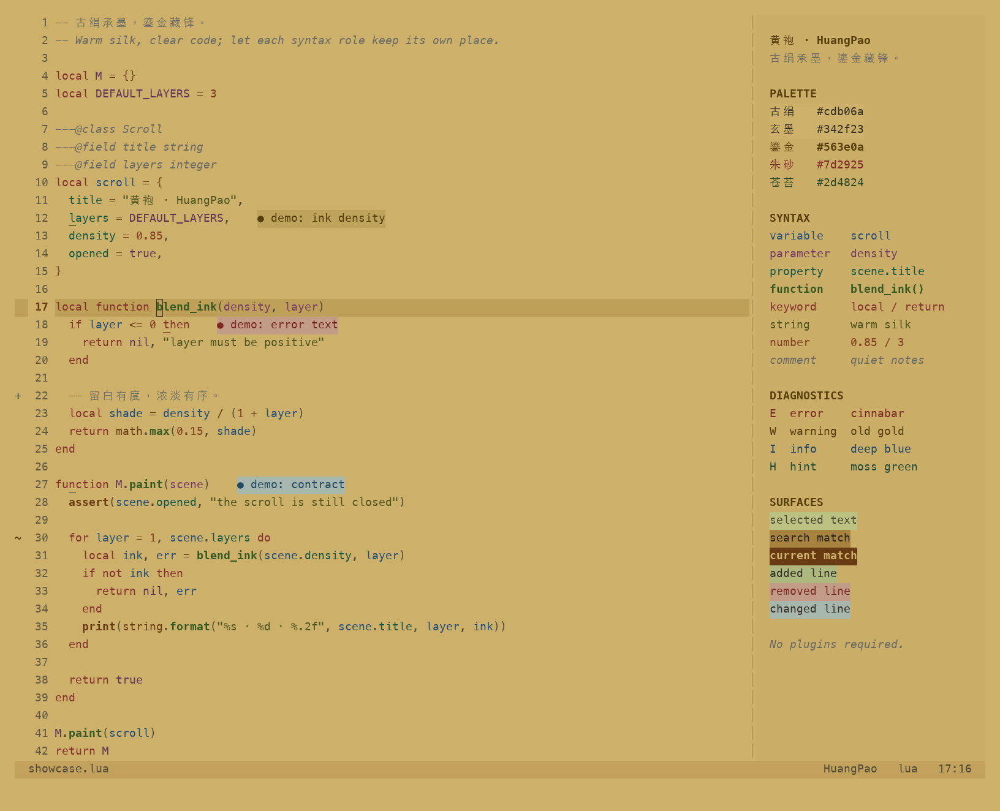

# 黄袍 · HuangPao

> 黄裳元吉 文在中也

> 黄袍加身 码上成王

古绢承墨，鎏金藏锋。一款以暖黄绢纸与玄墨文字为底色的 Neovim 浅色主题。



需要 **Neovim 0.9+** 与支持真彩色的终端，无插件依赖。

- 变量深蓝、参数梅紫，关键字砖红，函数草绿加粗，注释中性灰斜体。
- 支持 Treesitter、LSP、诊断、diff 与终端色，内置 lualine 主题。
- 适配 Telescope、Snacks、Neo-tree、nvim-tree、blink.cmp、nvim-cmp、gitsigns 等插件。
- 支持透明背景、非活动窗口变暗与高亮覆盖。

## 安装

使用 lazy.nvim：

```lua
{
  "wsgggws/HuangPao.nvim",
  lazy = false,
  priority = 1000,
  config = function()
    vim.cmd.colorscheme("huangpao")
  end,
}
```

使用 LazyVim 时，注册主题插件，并设置：

```lua
return {
  { "wsgggws/HuangPao.nvim", lazy = true },
  { "LazyVim/LazyVim", opts = { colorscheme = "huangpao" } },
}
```

本地安装可将仓库名替换为 `dir = vim.fn.expand("~/github/HuangPao.nvim")`。
安装后也可执行 `:colorscheme huangpao`。主题会自动启用 `termguicolors`。

## 配置

`setup()` 可省略；自定义时在加载主题之前调用：

```lua
require("huangpao").setup({
  transparent = false,
  dim_inactive = true,
  terminal_colors = true,
  styles = {
    comments = { italic = true },
    functions = { bold = true },
  },
  overrides = {},
})
vim.cmd.colorscheme("huangpao")
```

`overrides` 支持色板路径、十六进制颜色与高亮链接，例如：

```lua
require("huangpao").setup({
  overrides = {
    Comment = { fg = "comment", italic = false },
    MyGroup = "Comment",
  },
})
```

修改后重新执行 `:colorscheme huangpao`。`:HuangPaoTransparent` 可临时切换透明背景，完整选项见 `:help huangpao`。

## lualine

```lua
require("lualine").setup({ options = { theme = "huangpao" } })
```

## 色彩

| 角色          | 色值                  |
| ------------- | --------------------- |
| 背景 / 正文   | `#cdb06a` / `#342f23` |
| 注释 / 关键字 | `#6b6b65` / `#86312d` |
| 变量 / 参数   | `#254f78` / `#763b65` |
| 函数 / 字符串 | `#375a23` / `#4e551f` |

完整色板见 [palette.lua](lua/huangpao/palette.lua)。

## 其他配色

[extras/](extras/README.md) 提供 WezTerm、tmux、fzf、bat、delta、Alfred 与 slides 的同色板主题文件。

## 预览

```sh
nvim -u scripts/preview.lua
```

预览无需安装插件，展示代码、诊断、搜索与选区配色。开发与截图方法见 [CONTRIBUTING.md](CONTRIBUTING.md)。

## 许可

[MIT](LICENSE)
